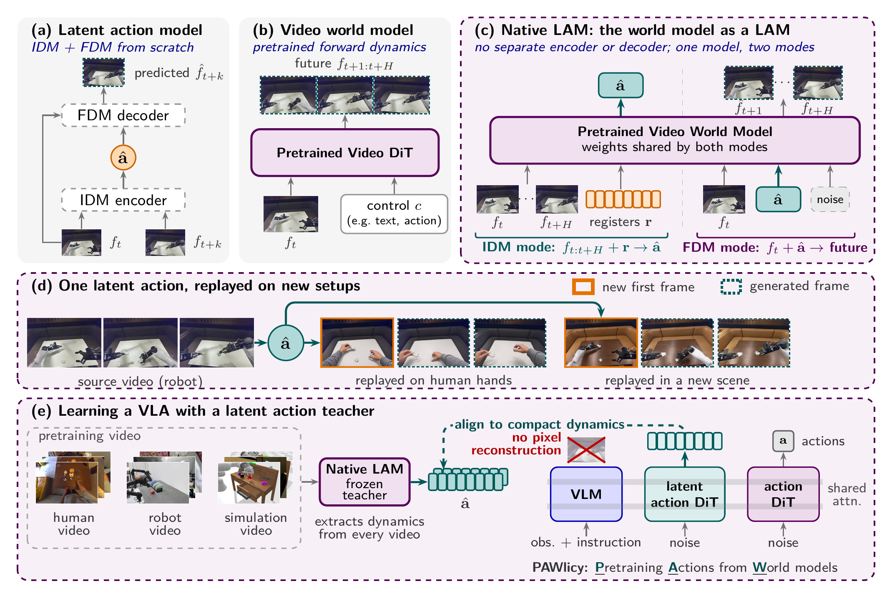

<div align="center">

# World Models as Native Latent Action Models

[Qinyue Li](https://www.linkedin.com/in/dienachtderwelt/)<sup>1*</sup>, Weijie Qiao<sup>1,2*</sup>, [Qingyi Tao](https://truetqy.github.io/)<sup>1*†</sup>, [Zerui Gong](https://ry3ng.github.io/)<sup>1</sup>, [Zhe Yang](https://savannah-yz.github.io/)<sup>2</sup>, [Quanzhou Li](https://quanzhou-li.github.io/)<sup>2</sup>, [Taolin Zhang](https://taolinzhang.github.io/)<sup>2</sup>, Jinglin He<sup>1</sup>, [Zhonghua Wu](https://wu-zhonghua.github.io/)<sup>1</sup>, [Chen Change Loy](https://www.mmlab-ntu.com/person/ccloy/)<sup>2,3</sup>

<sup>1</sup>SenseTime Research, Singapore &nbsp;&nbsp; <sup>2</sup>S-Lab, Nanyang Technological University &nbsp;&nbsp; <sup>3</sup>ACE Robotics

<sup>*</sup>Equal contribution &nbsp;&nbsp; <sup>†</sup>Project lead

[](https://arxiv.org/abs/2611.30898)
[](https://pawteam-eai.github.io/native-lam/)
[](https://huggingface.co/papers/2611.30898)
[](World_Models_as_Native_Latent_Action_Models.pdf)

</div>

<p align="center">
  
</p>

## Abstract

Large and diverse video sources carry rich dynamics, but often lack actions or a shared action space. **Native LAM** operates one pretrained video diffusion transformer as both an inverse- and forward-dynamics model, with learnable dynamics registers as the only causal bridge between the two. Counterfactual temporal pairs that differ in motion force those registers to distill a video's dynamics into a compact native latent action. These continuous latents are action-informative on LARY, replay source motion across scenes and embodiments, and interpolate into coherent intermediate motions.

A frozen Native LAM then serves as a dynamics teacher for **PAWlicy** (Pretraining Actions from World models). PAWlicy predicts compact latent actions and conditions motor commands on them, without generating video during policy training or inference. It reaches 93.6% average success on RoboTwin 2.0 under clean + randomized training, competitive RoboDojo results, and improvements over π<sub>0.5</sub> on two real-robot tasks. Both stages build on publicly released models and data.

## News

- **[2026-11]** Paper released on [arXiv](https://arxiv.org/abs/2611.30898). Project page is live at [pawteam-eai.github.io/native-lam](https://pawteam-eai.github.io/native-lam/).

## Code

Coming soon.

## Citation

If you find this work useful, please cite:

```bibtex
@article{li2026native,
  title   = {World Models as Native Latent Action Models},
  author  = {Li, Qinyue and Qiao, Weijie and Tao, Qingyi and Gong, Zerui and Yang, Zhe and Li, Quanzhou and Zhang, Taolin and He, Jinglin and Wu, Zhonghua and Loy, Chen Change},
  journal = {arXiv preprint arXiv:2611.30898},
  year    = {2026}
}
```
